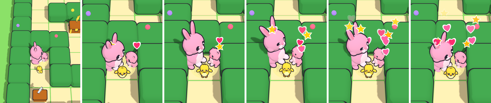
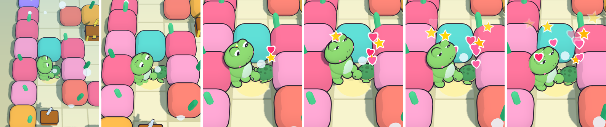
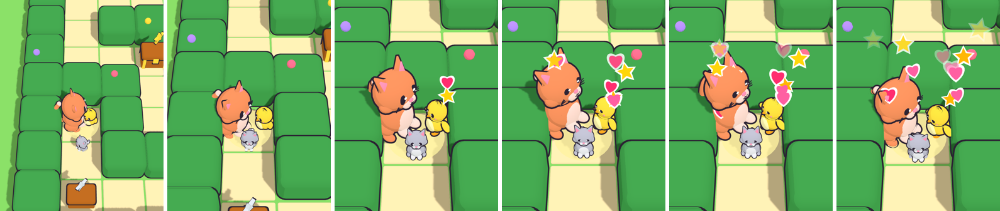
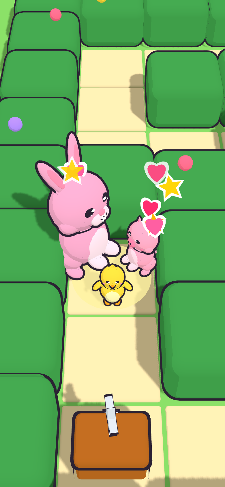
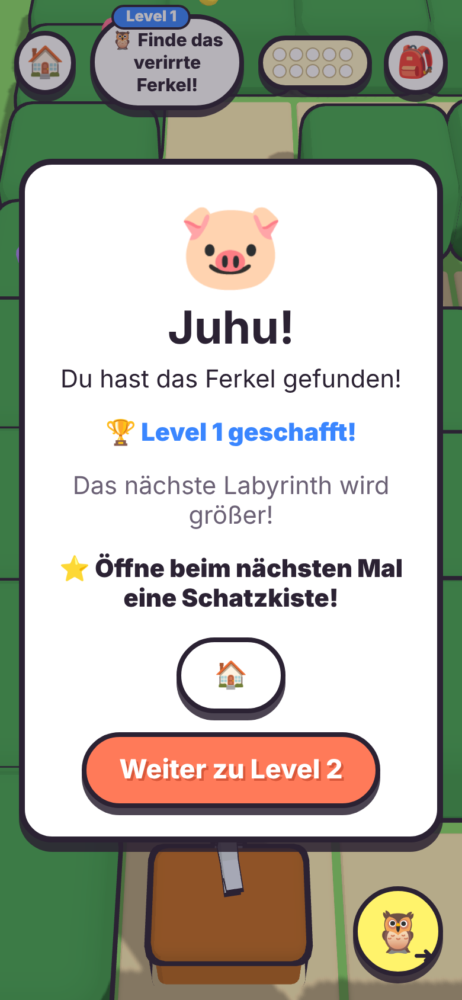
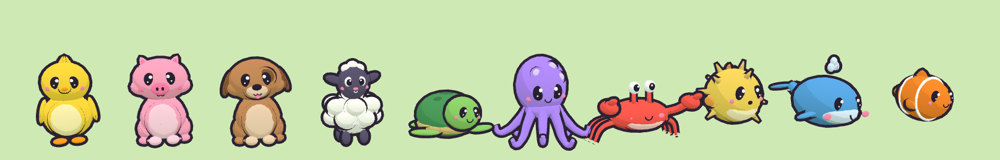
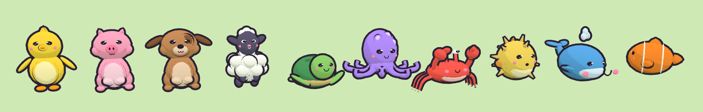

## What and why
When the child reaches the goal of a maze, a short **rescue cut-scene** now plays before the "Juhu!" dialog: the avatar and the found friend step side by side, turn to each other and **cheer together** while hearts and stars rise; the pet (if any) joins in front. About 4 s, **a tap skips it**. Owner decision via Fabian ("when a friend is found, a scene where both animals are happy to have found each other"; Fabian chose to remodel all lost friends in Blender and to give every animal its own cheer clip). New **ADR-0017**.

For this, all **ten lost friends are now hand-modelled, rigged glTF models** (like the avatars, ADR-0016), and **every animal has a `Cheer` clip**.

Rescue scene, frames at t ≈ 0.3 / 1.0 / 1.5 / 2.2 / 3.1 / 3.9 s (390×844 @2x, real build, canvas captured in-page right after render):

| Bunny finds the piglet, chick pet joins in front |
|---|
|  |
| **Frog finds the turtle (Unterwasserwelt, no pet)** |
|  |
| **Fallback: all model downloads blocked → procedural cat, chick and kitten hop in code** |
|  |

| Mid-scene 390×844 | Dialog afterwards (unchanged) |
|---|---|
|  |  |

The ten lost friends, built with the game code (`buildLostAnimal`, toon materials, outlines), Idle vs. Cheer:

## Design / decision
- **ADR-0017** (new, Proposed). Options: scene with procedural friends animated in code / model all friends + `Cheer` clip + in-engine scene (chosen) / pre-rendered video (too big, loses the child's colours and outfit).
- ADR-0015 and ADR-0016: status line only ("`Cheer` clip and rescue scene / lost friends added by ADR-0017"). Decision text unchanged.
- `game-design.md` §3 + §4a + changelog **v1.34**; `open-questions.md` #3 (precache now 4.5 MB of 5 MB, compression or lazy sea friends is the next lever) and #5.

## Scope
In: 10 friend models, `Cheer` clip for all 15 animals, skin-weight packing, rescue scene at the maze goal, tests, docs.
Out: scenes at chests or in the treehouse; changes to the dialog; compression (open question #3); Blender sources in the repo (open question #5).

## Scene behaviour (`src/render/rescueScene.ts`)
| Time | What happens |
|---|---|
| 0–0.8 s | Avatar → goal x −0.30, friend → x +0.32 (both z −0.10), turn to each other (yaw ±0.62·90°, i.e. a bit towards the camera); pet → front centre (z +0.34) facing the camera. Camera moves in (1.1 s, smoothstep) to ~0.5× distance, a little lower. All positions stay inside the goal tile. |
| 0.6–4.2 s | Everyone cheers: `setAnimalCheering(root, true)`; animals without a `Cheer` clip (procedural fallback) hop in code, out of phase. |
| 0.8–3.6 s | Hearts (60 %) and stars rise between them: white border, camera-facing, pop-in, fade in the last 40 %; one every 0.11 s, seeded RNG. |
| 4.2 s | Cheer off (cross-fade to idle), particles removed, promise resolves → `GameScreen` opens the dialog. |

- **Wall-clock time** (`performance.now`, per-frame dt capped at 0.25 s), so the scene lasts 4.2 s at 3 fps too (unit-tested at 3 and 60 fps).
- **Skip:** pointer down on the canvas, or Space / Enter / Escape → final poses, dialog at once.
- **`prefers-reduced-motion`:** 2.2 s, no camera move, a particle every 0.4 s.
- `GameScreen`: fanfare, speech, `onRescue` and `onMazeCompleted` still run **immediately** on `goalReached` (nothing lost if the app is closed mid-scene); only `setGoalStars` waits. New `rescuing` state pauses the maze and holds the reward picker back during the scene.
- Test hook: `data-rescue-scene="playing" | "done"` on the game canvas container (cleared per maze).

## Models
| Friend | KB | Notes |
|---|---|---|
| chick | 153 | |
| piglet | 220 | |
| puppy | 200 | floppy ears |
| lamb | 270 | fluffy wool lobes |
| turtle | 239 | shell `ShellDark` pattern, head out |
| octopus | 223 | tentacles rigged |
| crab | 177 | claws up, eye stalks |
| pufferfish | 143 | floats; spikes |
| whale baby | 147 | floats; water spout |
| clownfish | 123 | floats; stripes |

- Contract as the avatars (y=0, +z front, one skinned mesh per material, clips `Idle` 3.0 s / `Walk` 0.5 s / `Cheer` 1.5 s), **but colours come from the file**: materials `<friend>_<Slot>`; `friendMaterialSlot()` only decides the outline (none for `Dark`, `Pink`, `White`, `…Dark`). Modelled at avatar size, shown at `FRIEND_SCALE` 0.55 (unchanged size in the maze). Kitten and bunny baby stay the scaled cat/bunny models.
- Avatars re-exported with a `Cheer` clip (Idle/Walk unchanged).
- **Skin weights packed** from float32 to normalized `UNSIGNED_BYTE` (core glTF 2.0, no extension; rounding keeps each vertex's sum at exactly 255): ~20 % smaller. Avatars now 160–247 KB (were 186–292 KB).
- No textures, no extensions, no external URIs. CC0, own work (ASSETS.md).

## Changes (file → what)
| File | Change |
|---|---|
| `public/models/friends/*.glb` (new, 10) | see table |
| `public/models/{cat,bunny,bear,frog,penguin}.glb` | + `Cheer` clip, packed weights |
| `src/render/avatars/models.ts` | `ModelId = AvatarAnimal \| LostAnimal`; `MODEL_FILES` lists the friends; all functions take `ModelId` |
| `src/render/avatars/animation.ts` | `CHEER_CLIP`, `AnimalAnimator.cheer/cheering`, `setAnimalCheering()` (returns false without clip); `setAnimalMoving` only records state while cheering |
| `src/render/avatars/lostAnimals.ts` | `buildModelledFriend` (file colours as toon materials, scale 0.55, animator, outlines), `friendMaterialSlot`, `FRIEND_SCALE`; procedural friend kept as `proceduralFriend` fallback with in-place swap on load |
| `src/render/rescueScene.ts` (new) | pure `rescueTimeline(t, reduced)` + `RescueScene` (poses, cheer/hop, particles, skip, dispose), `prefersReducedMotion()` |
| `src/render/MazeView.ts` | `playRescueScene(): Promise<void>`, `skipRescueScene()`, skip on pointer/keys, wall-clock dt, scene camera, no chick bob / pet following during and after the scene |
| `src/ui/screens/GameScreen.tsx` | dialog after the scene; `rescuing` state in `blocked` and `holdPicker` |
| `src/render/rescueScene.test.ts` (new, 9 tests) | timeline phases, reduced motion, easing, poses, code hop vs. clip, particles cleaned up, skip, same duration at 3 and 60 fps |
| `src/render/avatars/modelFiles.test.ts` | + friend files: size (< 400 KB each, < 2.2 MB together), materials `<friend>_<Slot>`, bounds, rig, clips incl. `Cheer`, builds in file colours, cheers |
| `tests/e2e/goal.spec.ts` | waits for `playing` → dialog hidden → `done` → dialog; new test: a tap skips the scene |
| Docs | ADR-0017, ADR-0015/0016 status lines, `architecture.md` §8, `game-design.md`, `open-questions.md`, `ASSETS.md`, `AGENTS.md` ADR range 0001–0017 |

## Budget / performance
- 15 models, **2.88 MB** together; precache **4.5 MB** (was 2.7 MB) — still under "initial download < 5 MB", but close. Open question #3 now suggests compression or loading the sea friends only when the underwater world opens, before any further models.
- Scene keeps about 16 particles alive at a time (2 meshes each, shared geometry) for ~3 s; friends are 4–6 skinned meshes + outlines like the avatars.
- SwiftShader 390×844 @2x: scene timing exact (4.2 s wall clock at ~3 fps). **Real-phone check still open** (preview).

## Checks
- [x] `npm run check` → lint, typecheck, **493 unit tests** (+50), audio check OK.
- [x] `CI=1 npm run e2e` → **84 passed, 38 skipped** (the specs' own `test.skip` per viewport; +1 test), 0 failed, 0 flaky (16.9 min). Goal tests: 46 s (scene end) and 38 s (skip). Run with the system Chrome via a wrapper config outside the repo (Playwright browser download is blocked here); specs and `playwright.config.ts` otherwise unchanged.
- [x] `npm run build` → 15 `.glb` precached by the service worker, none bundled into `dist/assets`.
- [x] Real build 390×844: bunny/piglet with chick pet, frog/turtle underwater, procedural fallback with all models blocked; no console errors (except the intentionally blocked model requests).
- [x] Children-first: no new text or speech, short, skippable by any tap, calmer with reduced motion, nothing waits on the scene for saving.

## Review
Fork PR: preview after maintainer approval (ADR-0013). Suggested look: finish a Zauberwald maze with a pet equipped (scene, then dialog), finish one and tap during the scene (skip), try an underwater maze (fish float and cheer), and check the friend in the maze before you reach it (now the model, idling).

🤖 Generated with [Claude Code](https://claude.com/claude-code)

https://claude.ai/code/session_01K2HTqchwMzm5wLv1ZwSRer
