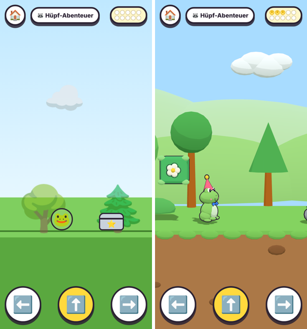
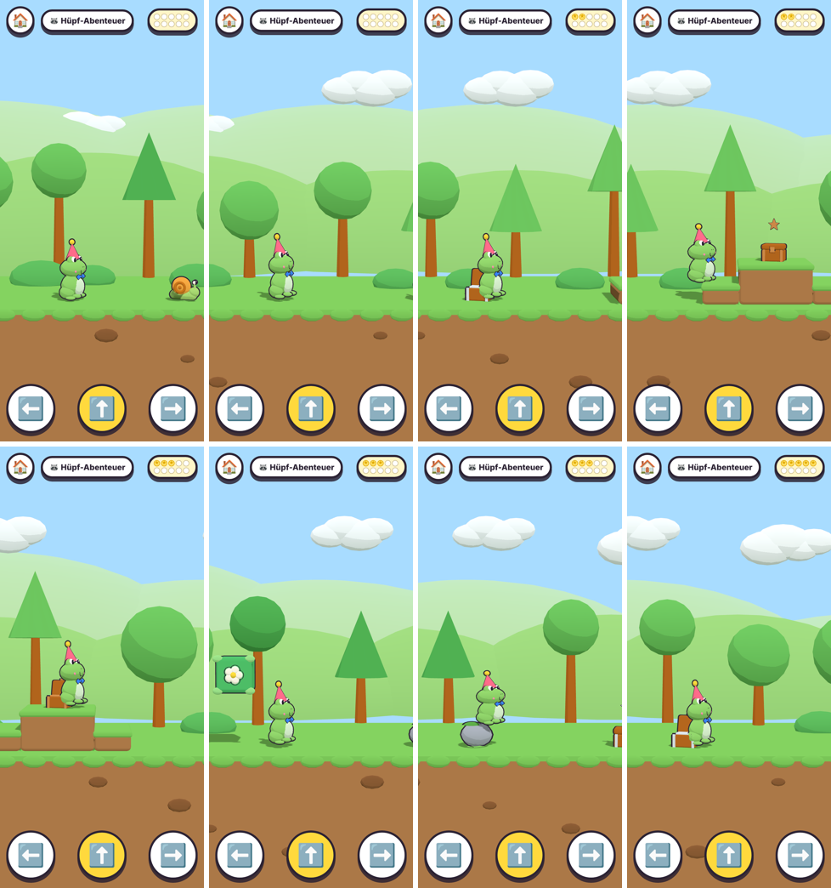
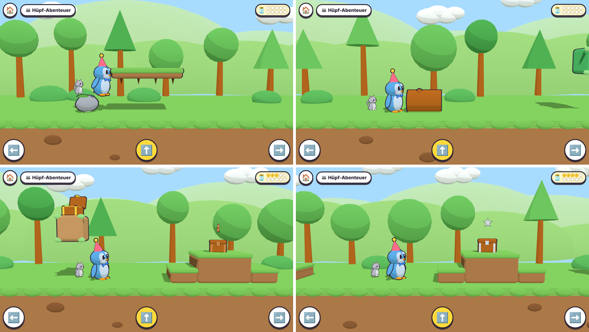

## What and why
The **Hüpf-Abenteuer** becomes a **3D side scroller** in the spirit of classic platformers, with its own look. Owner input via Fabian: "the hop game looks a bit dull, it's just a picture that hops — something like Super Mario?". Fabian picked the elements: **stairs and floating platforms, blocks you bump from below, friendly crawlers**; and **nothing can be failed** (no pits, no lives). It stays its own mini game (one look, not per maze world). Fabian: "please build it, Patrick can still reject the PR". New **ADR-0018**.

Before (DOM, main) → after (3D), same seed, frog, 390×844:

Frog run, 390×844 @2x real build (seed 11), every ~6 s: snail, stairs with chest, leaf block, stone, chests:

Desktop 1280×720, penguin with kitten pet: floating platform after a stone, log, used leaf block with its chest on top, staircase with chest:

## What the child gets
- **Their own animated animal** (ADR-0015…0017) with hat/glasses/neck item and the pet following; walk/idle clips, squash and stretch on jumps and landings, a wobble with dizzy stars on "Hoppla!", **cheering at the flag**.
- **Stairs** with a chest on top (climbed automatically, like obstacles).
- **Floating platforms** after about half of the logs/stones/mushrooms: an optional high road (hop up from the obstacle or the ground; you can hop through from below).
- **Leaf blocks** (green, flower emblem) replace "gold chest on a cloud": stand underneath and hop, the block bounces, the gold chest pops out on top and opens; the block turns wooden. No timing needed; tapping a block speaks the existing hint.
- **Friendly crawlers** (snail, ladybird) patrol a short stretch: hop on one and it tumbles away with a bounce (stars, pling); walk into one and it hides in its shell ("Hoppla!") and lets you pass.
- Parallax backdrop (trees, bushes, two hill layers, clouds), dust puffs on landing, waving flag.

## Children-first rules (unchanged, now unit-tested over many seeds)
- Nothing moves without a press. **Holding → alone reaches the flag on every course** and opens every chest except those in leaf blocks (as before with the high chests).
- A solid you walk into is a "Hoppla!", after 0.9 s the avatar climbs **onto** it (before: past it — needed for stairs, same feel for logs).
- No pits, no lives, no time limit; crawlers can't hurt.
- **No new spoken text** (audio clips are generated at build time), no new assets, no save change.
- Layout per stage unchanged (Kita 3 chests / 3 obstacles, Vorschule 4/5, school 5/7); about 2 in 5 obstacles are crawlers.

## Design / decision
- **ADR-0018** (new, Proposed). Options: keep DOM with nicer sprites / Three.js side view with the animated avatar and **toon props built in code** (chosen) / same with Blender props (the precache is at 4.5 of 5 MB, ADR-0017; simple shapes read well at this size). Not copying Mario's characters, "?" blocks or pipes.
- ADR-0010: status line only. `game-design.md` §4b row + changelog **v1.35**; `architecture.md` §8 activities row; `AGENTS.md` ADR range 0001–0018; skill `add-activity` learnings updated (3D view, never-fail rules).

## Changes (file → what)
| File | Change |
|---|---|
| `src/core/activities/jump.ts` | `Course` gains `platforms`, `blocks`, `crawlers`; `CourseChest.inBlock`; `JumpState.crawlers`; events `bump`, `stomp`, `land`; `floorAt` (ground/solids/one-way platforms); climb onto solids; head bump on blocks; crawler patrol / shy (2.5 s) / gone; generator with staircases, platforms behind obstacles, blocks for gold chests, crawler segments. Still pure. |
| `src/core/activities/jump.test.ts` | 11 tests (was 6): course layout over 18 stage×seed combos (no overlaps, gaps ≥ 3, platforms after obstacles, gold in blocks), walking-right-only on 5 seeds (exact climb/stumble counts, all walkable chests), block bump without timing (head stops at the block), jump over a log without stumble, platform land-from-above / hop-through / walk-off, step climb, stomp, bump-into-crawler passes, patrol bounds, chest re-open. |
| `src/render/JumpView.ts` (new) | Three.js view: camera fit (`cameraDistance`: 5.2 units across portrait, ≥ 6 tall on wide; `cameraX`: avatar at ⅓, clamped), follow + look up on platforms, sun shadow follows, avatar/pet animation, chest lids (solved), block bounce + chest pop, crawler walk/hide/tumble, puffs and stars, tap-on-block raycast. |
| `src/render/jump/jumpProps.ts` (new) | Toon props: ground (merged), log (turned so a ring shows), stone, mushroom, step, platform, leaf block (+ used look), snail, ladybird, flag, backdrop merged into 7 meshes. |
| `src/render/JumpView.test.ts` (new, 6 tests) | camera fit and clamping, props fill their logic boxes, platform top, used block, crawler parts, backdrop mesh count. |
| `src/ui/activities/JumpScreen.tsx` | Uses `JumpView`; loop calls `sync`/`handleEvents`, no React render per frame; hidden chest markers (`data-chest-index/-x/-high/-state`) for tests; pling on stomp. |
| `src/styles.css` | DOM scene rules removed, `.jump-canvas` added. |
| `tests/e2e/jump.spec.ts` | Asserts the 3D canvas; walking test unchanged otherwise (crawlers and stairs are passed by holding →). |
| Docs | ADR-0018, ADR-0010 status, `game-design.md`, `architecture.md`, `AGENTS.md`, `.claude/skills/add-activity/SKILL.md` |

## Budget / performance
- Precache unchanged apart from the JS bundle (props are code); no new `.glb`.
- Draw calls: backdrop 7 + ground 3 + avatar/pet as in the maze + props in view (frustum culled); one course segment is 2–25 meshes incl. outlines.
- SwiftShader 390×844 @2x plays smoothly enough for the walk-through; **real-phone check still open** (preview).

## Checks
- [x] `npm run check` → lint, typecheck, **504 unit tests** (+11), audio check OK.
- [x] `CI=1 npm run e2e` → **84 passed, 38 skipped** (the specs' own `test.skip` per viewport), 0 failed, 0 flaky (18.8 min); jump walk-through 75 s. Run with the system Chrome via a wrapper config outside the repo (Playwright browser download is blocked here).
- [x] Real build, full playthroughs: bunny + chick pet (390×844, seed 7), frog no pet (390×844, seed 11), penguin + kitten (1280×720, seed 5): all reached the flag, leaf blocks bumped, no console errors.

## Review
Fork PR: preview after maintainer approval (ADR-0013). Suggested look: open the Hüpf-Abenteuer from the hub, hop on a snail, walk into a ladybird, bump a leaf block, climb the stairs, try the platform; on desktop with arrow keys + Space.

🤖 Generated with [Claude Code](https://claude.com/claude-code)

https://claude.ai/code/session_01K2HTqchwMzm5wLv1ZwSRer
